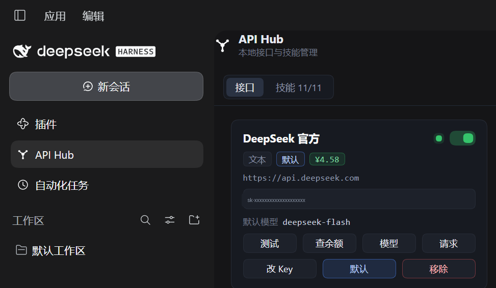

# API Hub

[](https://www.npmjs.com/package/dsh-api-hub)
[](https://github.com/Limooning/DSH-API-Hub/actions/workflows/ci.yml)
[](LICENSE)

跑在 [DeepSeek Harness](https://github.com/deepseek-ai/deepseek-harness) 里的**本机 API 与技能管理台**。

散在各个配置文件里的服务商——官方的、中转的、云厂商的——收进同一个面板：看余额、改 Key、选模型、测连通、发调试请求；顺手管理 DSH 会加载的技能。面板里启用的对话接口会**自动变成 DSH 自己的模型路由**，在对话的模型选择器里直接可选。



## 它是什么形态

侧边栏里的一行 + 一个原生 React 页面，后端逻辑跑在 **DSH 进程内**，挂在 DSH 自己的 HTTP 服务 `/api-hub` 下：

- 不额外开端口、不起子进程、不加载任何网页、没有 iframe
- 颜色全部来自 CSS 变量，深色 / 浅色各一份，跟着 DSH 的主题设置一起切
- 运行时数据都在 `~/.dsh/api-hub/`，仓库里没有任何密钥

> `package.json` 里的 `dsh.client.platform: "web"` 是 DSH 对「客户端插件」的称呼，指跑在渲染进程里，不是「这是个网页」。

## 安装

`dsh plugin` 会把包装进 profile，并自动把包名登记到该 profile 的 `dsh.profile.bundles`：

```powershell
dsh plugin --profile desktop add dsh-api-hub          # 从 npm
dsh plugin --profile desktop add C:\path\dsh-api-hub-<版本>.tgz   # 从 Release 附件
dsh plugin --profile desktop add link:C:\path\to\DSH-API-Hub      # 从源码，改动即时生效
```

装完**重启 DSH**，左侧边栏「插件」下方出现 **API Hub**。Windows / macOS 命令相同，只有路径写法不同。

卸载：

```powershell
dsh plugin --profile desktop remove dsh-api-hub
# 若 profile 的 dsh.profile.bundles 里仍留着 "dsh-api-hub"，手动删掉再重启
```

不用 CLI 的话：`cd ~/.dsh/profiles/desktop`，`pnpm add link:<仓库路径>`（或 `pnpm add <tgz 路径>`），把 `"dsh-api-hub"` 加进该 profile `package.json` 的 `dsh.profile.bundles`，重启。

## 三分钟上手

1. 打开左侧边栏的 **API Hub**
2. **＋ 添加接口**：填 Base URL 和 Key → 自动拉模型目录，每个模型旁标出能力（文本 / 视觉 / 图片 / 视频 / 语音 / 向量）→ 勾选要开放的模型 → 保存。类型不用选，按勾中的模型自动显示
3. 回到对话，在模型选择器里就能看到这个接口了

## 接口页

**整理**

- 拖动卡片排序；双击卡片标题改名（`id` 与 Key 文件不动）
- **导入配置**：把「设置 → 模型」那份 YAML（`providers:` 开头，或一个 `.yml` / `.yaml` / `.json` 文件）粘进对话框，解析出每个接口的地址、模型、Key 来源，勾选后一次导入；同名接口再粘一次是更新，不会多出一份
- 启用 / 停用：停用只淡化正文，标题和开关保持清晰
- 接口多了**只滚列表**：页头与标签页固定，滚到底不会带着整个设置页一起走
- 类型标签按能力分列：`文本` `视觉` `图片` `视频` `语音` `向量`，多模态写成「文本 · 视觉」
- **`视觉` 是实测出来的**：添加时真的发一张 16×16 纯红图问「什么颜色」，答得出来才标上；悬停能看到是实测通过、实测失败，还是仅按名字推断

**密钥与连通**

- Key 掩码显示在卡片上，**双击就地改**：粘贴后 `Enter` 保存，`Esc` 取消；失败时输入框保留并显示服务端原话
- `.toml` / `.env` 里的 Key 只读不写，会提示你直接改原文件
- **测试连接**：用真 Key 请求一次模型目录，显示状态码 / 耗时 / 模型数
- **查余额**：按 `balance` 配置查询；没有余额接口的服务商显示 `—`，不编造数字

**模型与默认**

- **模型**：拉目录、勾选允许的模型、单选默认模型
- **默认**：点一下设为默认；已经是默认的那张卡片，按钮会显示「已默认」（再点不会取消，改选别的接口即可）。文本与图片各有一个默认
- 只把这些勾选过的对话模型交给 DSH（见下文）

**调试**

- **请求**：GET / POST + JSON 请求体，带 Key 直发，显示状态码、耗时、响应体
- **移除**：确认后移出面板，面板自己管理的 Key 文件一并删除，它名下的 `APIHUB_*` 引用也收回（别的工具的 Key 不动）

**检索本机**

只列本机已有、面板里还没有的接口与技能：

- 自动扫描**只覆盖 DSH 自己的目录**——凭据库 `refs`、环境变量里的 `*_API_KEY` / `*_KEY`、`$DSH_HOME` 下的 JSON / TOML / `.env`
- 面板自己写进凭据库的 `APIHUB_*` 引用不列出：那是它给路由存 Key 的内部账本，名字由地址派生，本来就给不出可导入的 Base URL
- 放在别处的（D 盘、别的工具目录）用「扫描范围 → 手动导入」加一次路径；Key 仍留在原文件，只记录位置与字段
- **调通才允许导入**：每行都会拿它的 Key 真打一次接口，2xx 才点亮「导入」；调不通直接显示原因（`Key 被接口拒绝（HTTP 401）`、`Base URL 不对`、`连不上`），服务端写入前还会再验一次
- 鉴权头按实测结果定：`Authorization: Bearer` 被 401/403 拒掉时改试 `x-api-key` / `api-key`，能通的写法记在 provider 上
- Anthropic 原生（`/v1/messages`）与 Gemini 原生（`models?key=`）会明确告知「面板只调 OpenAI 兼容接口」，不假装成功

## 技能页

- 列出 **DSH 会加载的全部技能**：`$DSH_HOME/skills`、`$DSH_AGENTS_HOME/skills`，以及已打开项目里的 `.dsh/skills`、`.agents/skills`——同一 id 以优先级高的根为准，与 DSH 的加载顺序一致
- **只读范围**：项目和 `~/.agents` 里的技能带「只读」标记，面板不启停、不删除，只动 `$DSH_HOME/skills` 里的
- **名字不合规会提示**：DSH 只加载 `^[a-z0-9]+(-[a-z0-9]+)*$` 的 `name:`
- **拖动排序**：顺序存在 `~/.dsh/api-hub/skill-order.json`，新技能排在已排序的后面
- **双击改名**：只改 `SKILL.md` 顶部的 `name:`，描述与正文原样保留，行尾跟随文件（CRLF / LF）
- **打标签分类**：最多 12 个标签，存在 `~/.dsh/api-hub/skill-tags.json`，不动技能目录；顶部可按标签筛选，包括「未分类」
- **查看** SKILL.md 原文、**启停**（在 `skills/` 与 `skills/.disabled/` 之间移动）、**删除**

## DSH 模型页（只读镜像）

第三个标签把「设置 → 模型」里正在生效的行原样搬过来，省得来回切页确认 DSH 到底认了什么：

- 每行标出归属：`面板管`（「接口」页写入的路由）、`手加`（你在设置页自己加的 provider）、`DSH 内置`（账号与自带 DeepSeek）
- 显示模型数与模型名、Base URL
- **`未配置` 看的是凭据能不能解析**，不是「配置里有没有明文字段」：DSH 的 DeepSeek 段只写引用名（`DEEPSEEK_API_KEY`），Key 存在凭据库里，所以面板写了 Key 这行就显示已配置
- **只读**：这一栏不写任何东西。改模型回设置页，改面板自己的路由去「接口」页
- 数据来自设置服务的 `describe()`（密钥已打码），所以连面板不认识的插件注册的行也会列出来

## 和 DSH 的关系

### 模型自动接入，没有按钮

面板一有改动就和 DSH 的 `llm-pi-ai` 设置章节对齐，不用回到面板、也不用点任何按钮：

- 保存模型、改默认模型、启停 / 加 / 删 / 改名 / 排序接口、改 Key —— 任何一次写入都会在后台排一次同步（250ms 去抖）
- 启用中的对话接口注册成 DSH 的模型路由，写完 DSH 自己校验并热加载；每条路由的模型顺序把**默认模型放第一位**，命令面板里默认选中的就是它
- **只有不一致时才写一次**；停用或删掉的接口会从 DSH 模型列表里一并撤掉
- 你在「设置 → 模型」里手加的 provider 不会被碰：只动面板自己拥有的那几条
- 只接你勾选过的对话模型；图片 / 视频 / 语音 / 向量按名字分类后排除
- Key 通过 DSH 凭据服务落成 ref，不落到配置文件里；值已经一致就不重写
- 接口的 Key 会**复制到自己名下的 ref**（`APIHUB_<名字>_API_KEY`），不再借用 `DEEPSEEK_API_KEY` 这类原始 ref —— 否则 DSH 自带的 DeepSeek provider 会读到同一把 Key，两个入口列出一模一样的模型；原始 ref 保持原样，自带 provider 和联网搜索不受影响
- 端点就是 **DSH 自带 provider 那个**的接口（如 `api.deepseek.com`）不注册路由：面板只把 Key 写进它读的 ref，模型列表由 DSH 自己给，所以「设置 → 模型」里那一行既是 DSH 自带的、也是面板在管的，不会变成两行；卡片上的「DSH 内置」点一下就改成单独占一条路由（另一个账号、前面加代理时用），再点一下交回
- 面板自己名下的 `APIHUB_*` 引用，没有接口再指的时候会清掉；DSH 的 `DEEPSEEK_API_KEY` 和别人的 Key 一律不碰
- 撤不掉的路由如实报告：DSH 的设置服务不能 unset 时，`/api/dsh/sync` 把它们列进 `stuck`，归属名单保留，下次还能撤

### 兼容范围

`package.json` 声明了 `engines.dsh`：

```json
"engines": { "dsh": ">=0.2.1-rc.2 <0.3.0-0" }
```

DSH 安装时会拿它和运行时版本比对，不满足直接拒绝安装（`incompatible-version`），不会先装进去再出问题。所以这个范围写保守：只在真的对着新版跑过之后才放宽。

面板页头右上角显示 `DSH <版本> · v<插件版本>`，悬停可看声明的范围；对不上时页头下方出一条红字，而不是让接口悄悄调不通。数据来自 `/api/health` 的 `plugin` 与 `dsh` 字段（`dsh.version` 为 `null` 表示当前环境读不到，此时不报警）。

发布前和每周一 CI 都会跑：

```powershell
npm run check:dsh
# ok: @deepseek-ai/dsh@<版本> satisfies engines.dsh ">=0.2.1-rc.2 <0.3.0-0"
```

它去 registry 取 `@deepseek-ai/dsh` 的 `latest`，用与 DSH 同一套规则比对：落在范围外就以非零退出码失败（提示先手工装新版试一遍再放宽）；网络不通只警告，不判红。

### 主题

面板的颜色全部是 CSS 变量（`--ahb-*`），浅色在 `body`、深色在 `body[data-ds-dark-theme]` 各给一份。DSH 切换主题时浏览器直接重算，不需要监听事件或重建组件。

这些变量都映射到 DSH 的 `--dsw-alias-*`（`label-primary`、`bg-layer-1/2`、`border-l2/l3`、`state-success/error`…），所以面板和「插件市场」用的是同一套颜色；字面值只在宿主没提供该别名时兜底。半透明的卡片是 `color-mix(bg-layer-1 92%, transparent)` 加 `backdrop-filter`。

### 为什么入口在侧边栏，而不是设置页

DSH 的设置页导航图标按分区 id **硬编码**，第三方分区一律回退成齿轮，且 `settings.section` 没有 `icon` 字段；而 `sidebar.panellist` 的第二个参数就是图标组件。所以本插件只注册侧边栏席位，不在设置页留一个重复条目。上游需求整理在 [`docs/upstream/settings-section-icon.md`](docs/upstream/settings-section-icon.md)。

## 数据存在哪

全部在 `~/.dsh/api-hub/`（随 `$DSH_HOME` 走），都不进版本库：

| 文件 | 内容 |
|---|---|
| `providers.json` | 注册表：服务商、默认项、模型选择、缓存 |
| `keys/<id>.json` | 面板添加的接口的 Key |
| `dsh-routes.json` | 面板写进 DSH 的路由清单（用来判断能否安全撤掉） |
| `skill-order.json` | 技能排序 |
| `skill-tags.json` | 技能标签 |
| `scan-sources.json` | 手动添加的扫描位置 |

首次运行时 `providers.json` 不存在会自动从包内的 `providers.example.json` 复制一份（只含 DeepSeek 官方）。

### Key 存哪里

由 `keySource.type` 决定，面板只负责读写：

| 类型 | 位置 |
|---|---|
| `dsh-credentials` | DSH 凭据库的 `refs.<ref>`，写入交给 `ctx.credentials`（持锁、原子落盘、广播更新） |
| `json` | 任意 JSON 文件的某个字段（`path` + `jsonPath`） |
| `env` | 环境变量名，适合从 shell 传 Key |
| 面板添加的接口 | `~/.dsh/api-hub/keys/<id>.json` 的 `apiKey` |

写入是就地更新：`refs` 之外的记录、JSON 的其它字段与缩进风格都保留，值没变时文件逐字节不变。

### providers.json 参考

```jsonc
{
  "defaults": { "llm": "deepseek-api", "image": null },
  "providers": [
    {
      "id": "deepseek-api",
      "name": "DeepSeek 官方",
      "kind": "llm",                          // llm | image
      "enabled": true,
      "baseURL": "https://api.deepseek.com",
      "protocol": "OpenAI Responses",         // 仅展示
      "keySource": { "type": "dsh-credentials", "ref": "DEEPSEEK_API_KEY" },
      "test": { "method": "GET", "path": "/models" },
      "defaultModel": "deepseek-flash",
      "balance": {
        "method": "GET",
        "path": "/user/balance",
        "extract": ["balance_infos", 0, "total_balance"],
        "currency": "CNY",
        "label": "账户余额"
      }
    }
  ]
}
```

| 字段 | 含义 |
|---|---|
| `enabled` | 是否启用；缺省视为启用 |
| `selectedModels` | 允许调用的模型 id；不写 = 全部 |
| `defaultModel` | 默认模型，必须在 `selectedModels` 里 |
| `balance` | 余额查询，`extract` 是从响应 JSON 取值的路径 |
| `modelsCache` | 拉取模型后的缓存（面板自动写入） |

## 开发

不需要构建：

| 改什么 | 生效方式 |
|---|---|
| `lib/server.mjs`（后端） | 宿主按 mtime 自动重新 import，刷新页面即生效 |
| `lib/client.js`（界面） | 保存后刷新；没变化就重启 DSH（客户端模块图在启动时确定） |
| `lib/index.js`（宿主半侧） | 需要重启 DSH |

```powershell
node --check lib/server.mjs
node --check lib/index.js
node --check lib/client.js
npm test          # 每个用例在子进程里用一次性 HOME 跑，不碰你的数据
npm run check:dsh # 声明的 DSH 范围是否还覆盖最新发布
```

CI 在 Windows / macOS / Linux × Node 20/22 上跑同一套检查，外加一个每周的 `dsh-compat` 任务（`.github/workflows/ci.yml`）。

想在不碰日常环境的前提下试：复制一个 profile，装好插件后 `dsh --profile lab --port 17899 --no-open`。

### 目录结构

仓库根目录就是 npm 包：

```
package.json                插件清单：dsh.bundle.patch + dsh.client + engines.dsh
cordis.patch.yml            自带 patch 层，插入 api-hub-plugin 条目
lib/index.js                宿主半侧：挂路由、注入 origin、把 DSH 服务接给后端
lib/client.js               客户端半侧：侧边栏入口 + 原生面板
lib/server.mjs              后端：providers / 余额 / 模型 / 技能 / 检索 / 接入 DSH
scripts/check-dsh-compat.mjs 发布前的兼容性检查
test/smoke.test.mjs         一次性 HOME 里的冒烟测试
providers.example.json      注册表示例，首次运行自动复制
assets/icon.svg             枢纽标记（纯色，跟随主题）
```

## 已知限制

- **设置页没有入口**：图标只能是齿轮，所以只保留侧边栏入口
- **没有配置 schema**：刷新间隔等仍是代码里的常量，未接入 `cordis.patch.yml` 的 `config`
- **依赖 `webServer` 服务**：拿不到该服务时面板无法工作，不会退化成子进程
- **本地回环、无鉴权**：只挂在 `127.0.0.1` 上，外部机器连不上；但同一浏览器里的网页能读 `/api-hub/api/*` 的响应（CORS 通配）。不要把 DSH 绑到 `0.0.0.0` 后暴露在不可信网络里——那种场景需要额外的 token 校验，目前没有
- **只在 Windows 上实测过**：代码无平台分支，macOS 未验证

遇到「面板打不开 / 显示找不到面板服务」，见 [故障排查](docs/troubleshooting.md)。

## 文档

- [变更记录](CHANGELOG.md)
- [故障排查](docs/troubleshooting.md)
- [安全说明](SECURITY.md) — 回环与鉴权的取舍，如何私下报告问题
- [发布指引](docs/publish.md) — npm 发布与版本流程（维护者用）
- [上架材料](docs/market-entry.md) — 插件市场 PR 的条目内容与要求
- [上游需求](docs/upstream/settings-section-icon.md) — 让设置分区支持自定义图标

## License

MIT
